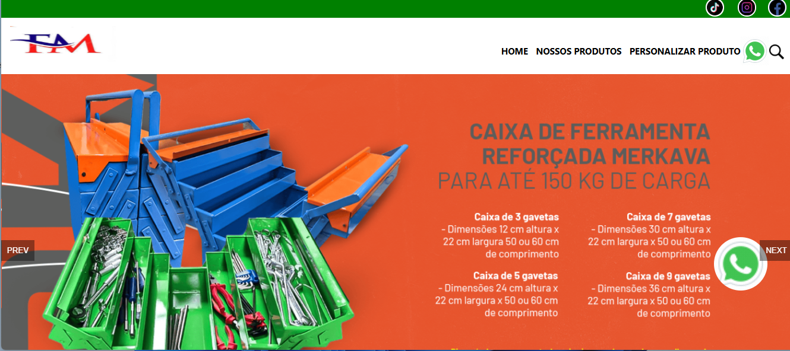
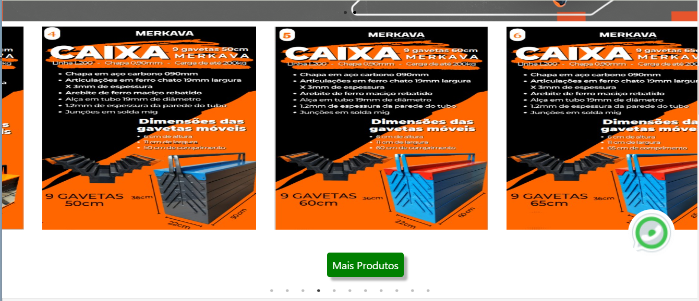
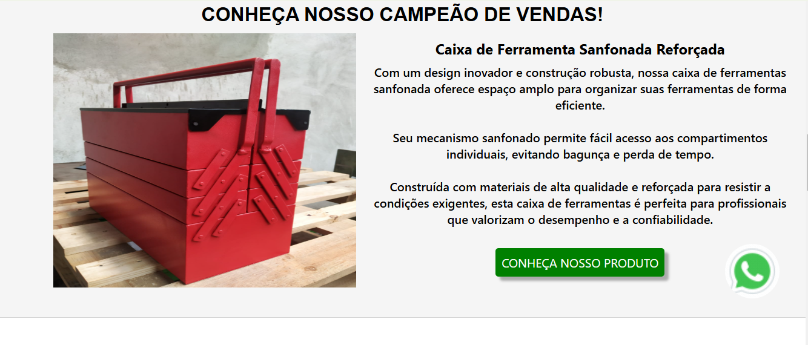
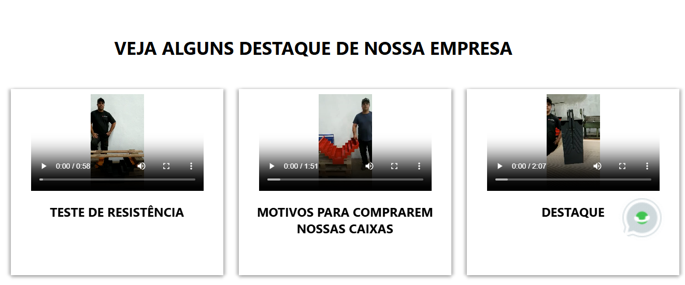
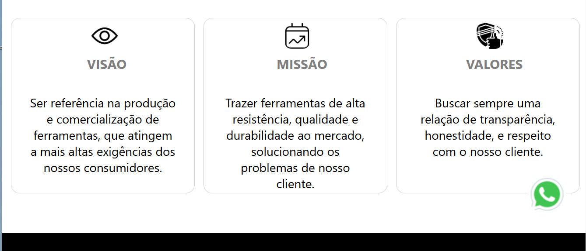
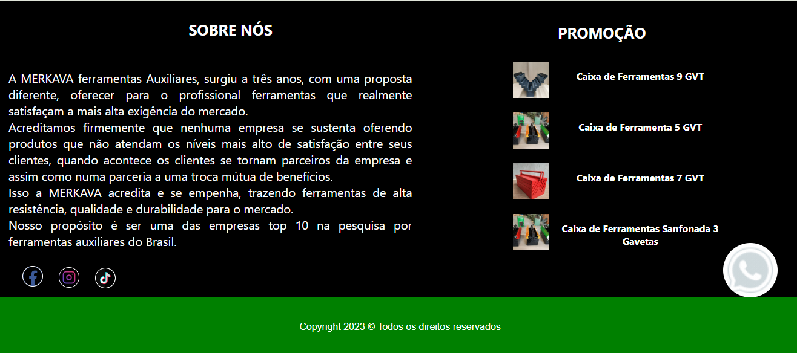
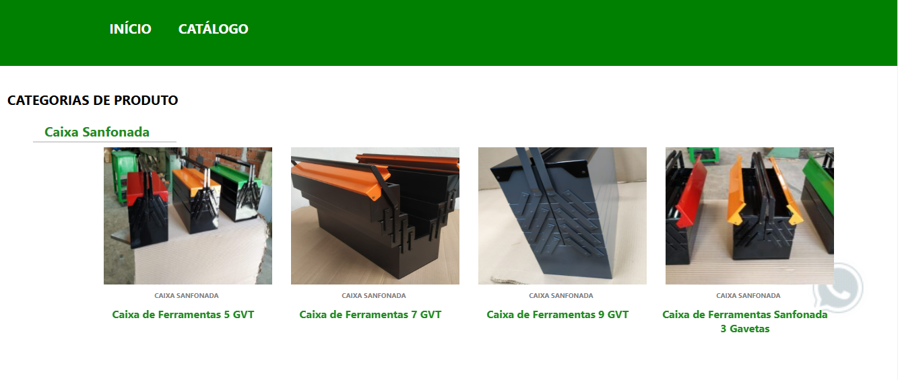
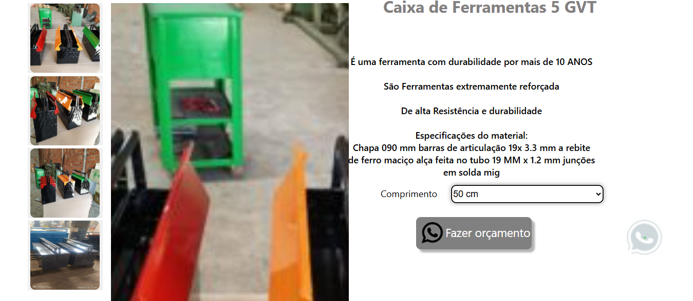
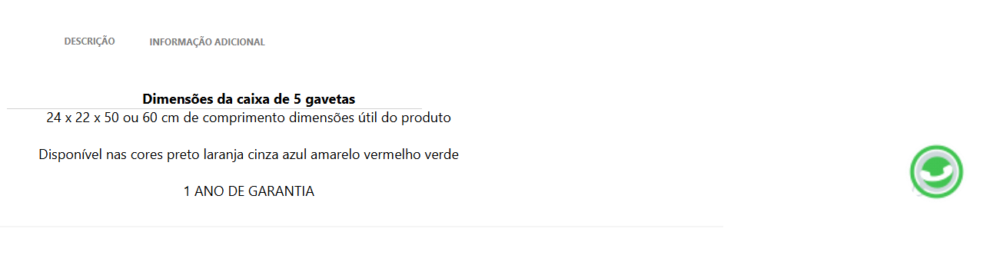
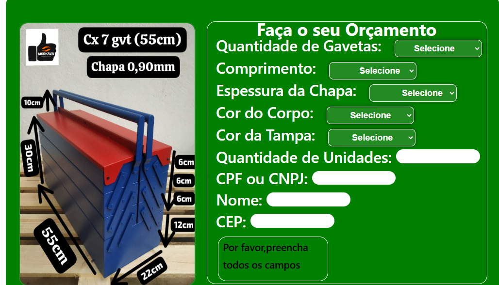

 <h2 align="center" > Status do Projeto: Concluido :heavy_check_mark: </h2>
 <h1 align="center">Tecnologias Usadas:</h1>
      <ul >
        <li>JavaScript</li>
        <li>HTML</li>
        <li>CSS</li>
        <li>SASS</li>
        <li>REACT</li>
        <li>NUKA-CAROUSEL</li>
        <li>BOOTSTRAP</li>
        <li>REACT-FLICKING</li>
          </ul>
          
Este projeto e uma melhoria da versão dois que estou criando o readme que não tinha ,adaptavel para celulares e diferentes telas de monitores e televisão.   OBS: DENTRO DA PASTA MERKAVA-2 ,TEM UMA PASTA FOTO E VIDEO ,LA TEM UM VIDEO DO SITE.

    
    
    
    
    
    
    
    
    
    
    <video src="./merkava-versao2/fotos-e-videos-do-site/Gravação de Tela 2025-06-22 151624.mp4">
